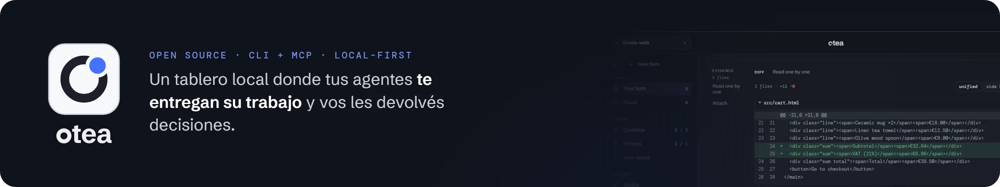
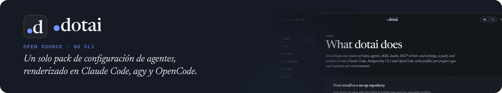
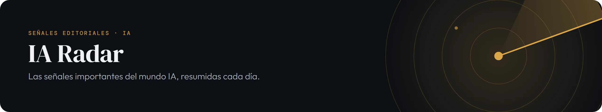
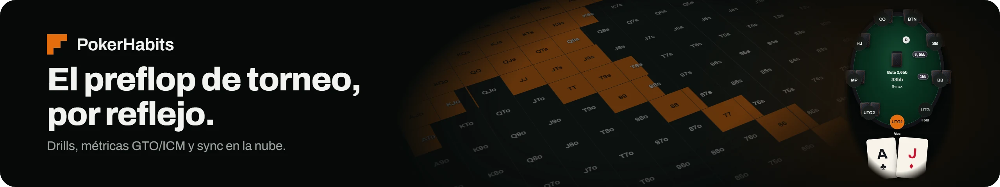
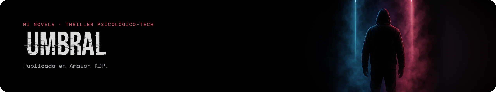
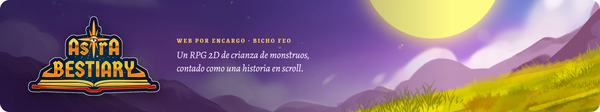

# Federico Daniel Ara

**Software Engineer · Arquitectura & Sistemas Distribuidos · IA aplicada**

Trabajo en el equipo de Arquitectura e Innovación de Inditex diseñando e implementando sistemas distribuidos con IA integrada. 
Defino la arquitectura, tomo las decisiones de diseño y llevo los sistemas a producción de principio a fin.

 

### Open source

<a href="https://github.com/otea-dev/otea">otea-dev/otea</a> · <a href="https://www.npmjs.com/package/@otea/cli">npm</a> · <a href="https://github.com/otea-dev/otea/releases/latest">releases</a> &nbsp;—&nbsp; TypeScript · Node · Electron · MCP

<a href="https://github.com/Lartweib/dotai">Lartweib/dotai</a> · <a href="https://github.com/Lartweib/dotai/releases/latest">releases</a> · pack: <a href="https://github.com/Lartweib/dotai-lartweib-pack">dotai-lartweib-pack</a> &nbsp;—&nbsp; Go · Claude Code · agy · OpenCode

### Proyectos propios

<a href="https://iaradar.info">iaradar.info</a> &nbsp;—&nbsp; React · Vite · TypeScript

<a href="https://pokerhabits.es">pokerhabits.es</a> &nbsp;—&nbsp; Next.js · React · Supabase

<a href="https://www.umbral.run">umbral.run</a> &nbsp;—&nbsp; mi novela y su web · Next.js

### Por encargo

<a href="https://astrabestiary.com">astrabestiary.com</a> · <a href="https://store.steampowered.com/app/3529090/Astra_Bestiary/">Steam</a> &nbsp;—&nbsp; diseñada y construida para Bicho Feo · Astro · Cloudflare Workers

